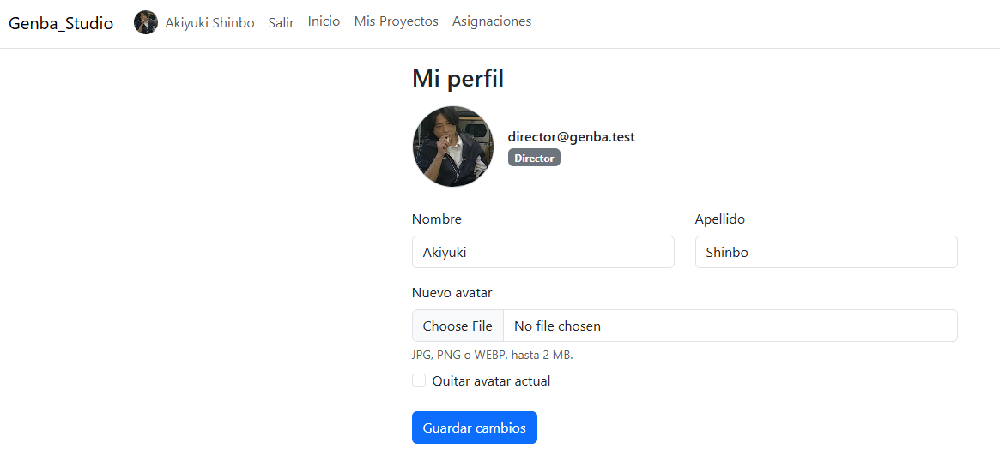
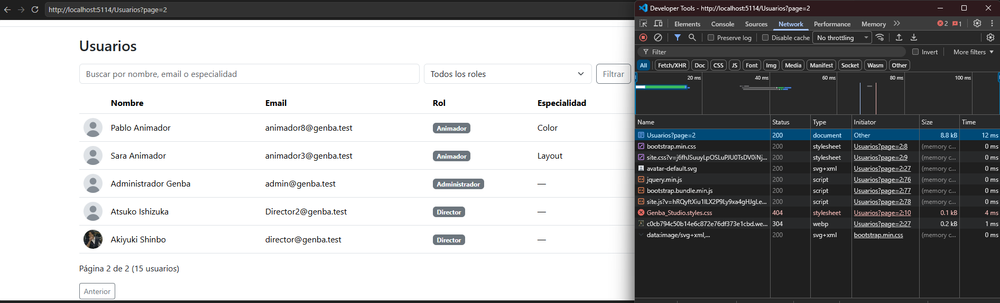
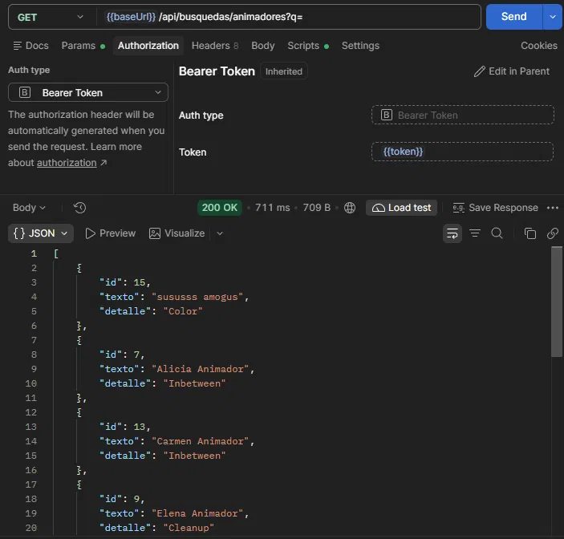

# Descripcion

Proyecto Integrador final para la materia Laboratorio de Programacion II

Un sistema de gestion de proyectos dirigido a un estudio de animacion con multiples Directores, Animadores con diferentes especialidades, Proyectos y Escenas.
Busca administrar mejor los proyectos y mantener un registro claro del proceso de produccion.

# Evidencia

<table>
  <thead>
    <tr>
      <th>Requerimiento Mínimo</th>
      <th>Estado</th>
      <th>Enlace al Código / Controladores</th>
      <th>Evidencia (Captura / GIF / Video)</th>
    </tr>
  </thead>
  <tbody>
    <tr>
      <td><b>1. 4 Tablas y Relación 1:N</b></td>
      <td>✅ Cumplido, Asignacion es la tabla intermedia, Animador a Escena es N:M</td>
      <td><a href="Data/AppDbContext.cs">AppDbContext.cs</a></td>
      <td></td>
    </tr>
    <tr>
      <td><b>2. Login, Roles y Avatar</b></td>
      <td>✅ Cumplido, se utilizo Identity para el manejo de usuarios, roles y autorizacion</td>
      <td><a href="Controllers/AccountController.cs">AccountController.cs</a></td>
      <td></td>
    </tr>
    <tr>
      <td><b>3. Manejo de Archivos (Extra)</b></td>
      <td>✅ Cumplido, Se sube una imagen de storyboard al crear una escena</td>
      <td><a href="Controllers/EscenasController.cs#L86">EscenasController.cs#L86</a></td>
      <td>Video corto / GIF mostrando subida de comprobante</td>
    </tr>
    <tr>
      <td><b>4. ABM en Vue.js + AJAX</b></td>
      <td> ✅ Cumplido </td>
      <td><a href="wwwroot/js/asignaciones.js">VueComponent.js</a></td>
      <td>Video corto / GIF del ABM dinámico</td>
    </tr>
    <tr>
      <td><b>5. Paginado por Servidor</b></td>
      <td>✅ Cumplido</td>
      <td><a href="models/PagedResult.cs">PagedResult.cs</a> , <a href="models/Repos/EscenaRepository.cs#L12">EscenaRepository.cs/GetPaginaAsync()</a></td>
      <td></td>
    </tr>
    <tr>
      <td><b>6. Selección Asíncrona (AJAX)</b></td>
      <td> ✅ Cumplido, se realiza al seleccionar Animador y Escena en la vista de asignaciones</td>
      <td><a href="views/Asignaciones/Index.cshtml#L36">Asignaciones/Index.cshtml#L36</a> , <a href="controllers/BusquedasApiController.cs">BusquedasApiController.cs</a></td>
      <td>GIF buscando entidades en desplegable</td>
    </tr>
    <tr>
      <td><b>7. Web API + JWT</b></td>
      <td>✅ Cumplido, se utiliza la API en la vista Vue de asignaciones</td>
      <td><a href="Controllers/AuthApiController.cs">AuthApiController.cs</a> , </td>
      <td></td>
    </tr>
  </tbody>
</table>

# Pasos a seguir para correr localmente

## Requerimientos

- .NET SDK 9.0 (NET 10 NO FUNCIONA, Ciertas dependencias necesitan NET 9)
- MySQL Server 8.0 o superior
- IDE recomendado: Visual Studio Code
- Interfaz recomendada para la Base de Datos: DBeaver

## Pasos

- Clonar el repositorio
- Configurar los user secrets con los siguientes comandos (Asegurarse de estar en la carpeta base del proyecto):

    ### Para la base de Datos:

  `dotnet user-secrets init`

  `dotnet user-secrets set "ConnectionStrings:Default" "Server=localhost;Port=3306;Database=BASEDEDATOS;User=USER;Password=TU_CLAVE"` (asegurarse de cambiar los valores segun tu base de datos)

    ### Para el seed (Recomendado mantener los valores proporcionados):

  `dotnet user-secrets set "Seed:AdminEmail" "admin@genba.test"` (Es el email del usuario admin)

  `dotnet user-secrets set "Seed:Password" "Admin123%"` (Sera usada para todos los usuarios creados por el seeder)

  `dotnet user-secrets set "Seed:DemoUsers" "true"` (False no corre el seeder)

- Crear una base de datos vacia
- Si no se tiene instalada previamente, se debe instalar la siguiente herramienta: `dotnet tool install --global dotnet-ef`
- Correr el comando: `dotnet ef database update`
- Y eso deberia ser suficiente!

## Usuarios Generados por Seed

<table>
  <thead>
    <tr>
      <th>email</th>
      <th>contraseña</th>
    </tr>
  </thead>
  <tbody>
    <tr>
      <td>Admin@genba.test (Email elegido en user-secrets)</td>
      <td>Admin123% (Clave elegida en user-secrets)</td>
    </tr>
    <tr>
      <td>Director@genba.test</td>
      <td>Admin123% (Clave elegida en user-secrets)</td>
    </tr>
    <tr>
      <td>Animador1@genba.test (Animador1 hasta Animador11)</td>
      <td>Admin123% (Clave elegida en user-secrets)</td>
    </tr>
  </tbody>
</table>

  
